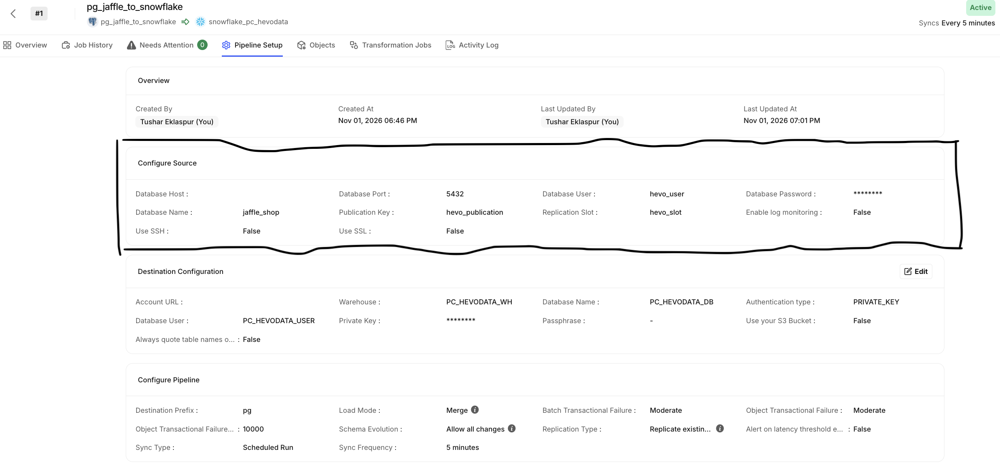
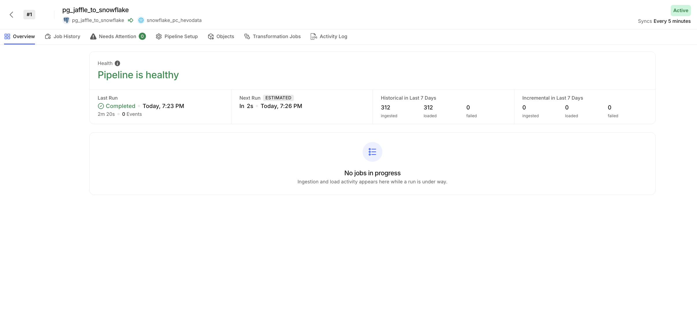
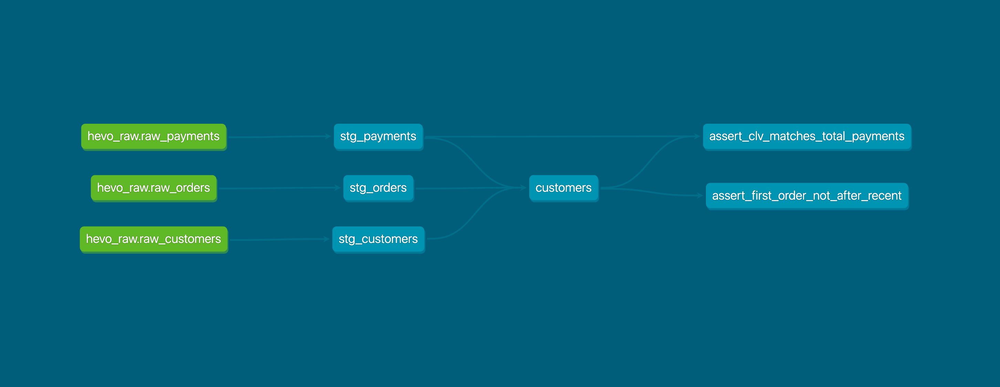

# Hevo Data exercise: PostgreSQL to Snowflake with Hevo, modelled with dbt

This project replicates three raw tables from a self-hosted PostgreSQL database to Snowflake with a Hevo pipeline using **Logical Replication** (publication and replication slot, `pgoutput`). dbt then builds a `customers` table with order history and lifetime value, with tests.

```
CSV files -> PostgreSQL 16 (Docker on AWS EC2) -> Hevo (Logical Replication) -> Snowflake (raw) -> dbt -> customers
```

No credentials, hosts, account names or keys are stored in this repository. Every value comes from environment variables or from files outside the project.

Demo video: (https://www.loom.com/share/7ea725c9c7c44062a2b5cbe729c871e3)

## Repository layout

| Path | Purpose |
|---|---|
| `data/` | The three source CSVs, unchanged |
| `setup/` | Scripts that build the PostgreSQL source |
| `models/staging/` | Source definition and staging views (rename columns, filter rows deleted at the source) |
| `models/marts/customers.sql` | The `customers` table |
| `tests/` | Custom data tests |
| `profiles.example.yml` | dbt connection template (environment variables only) |
| `docs/` | Screenshots |

## Prerequisites

- A Linux VM with Docker that Hevo Cloud can reach on port 5432 (here: AWS EC2, Ubuntu 24.04, Mumbai)
- Python 3.12 and dbt Core 1.10+ with the Snowflake adapter: `pip install dbt-core dbt-snowflake`
- A Snowflake account and a Hevo account

## 1. Build the PostgreSQL source

Run on the Docker host, from the project root:

```bash
read -s PG_SUPERUSER_PASSWORD; export PG_SUPERUSER_PASSWORD
./setup/01_start_postgres.sh        # PostgreSQL 16 with wal_level=logical, replication slots and WAL senders
./setup/02_load_data.sh             # creates raw_customers, raw_orders, raw_payments (primary keys) and loads data/
./setup/03_hevo_user.sh             # hevo_user with REPLICATION and SELECT, publication hevo_publication; asks for its password
./setup/04_allow_replication.sh     # pg_hba.conf entry for replication connections
```

Then create the logical replication slot the Hevo pipeline uses:

```bash
docker exec hevo-pg psql -U postgres -d jaffle_shop -c "SELECT * FROM pg_create_logical_replication_slot('hevo_slot', 'pgoutput');"
```

## 2. Network access for Hevo

PostgreSQL runs on an AWS EC2 VM with an Elastic IP. The security group allows port 5432 only from Hevo's published IP addresses for the India (Mumbai) region. Port 22 is open only to the administrator's IP. For a production customer I would add SSL and use Hevo's SSH tunnel option, and turn on Hevo's WAL log monitoring.

## 3. Hevo pipeline

- Source: PostgreSQL, log-based **Logical Replication** with publication `hevo_publication` and replication slot `hevo_slot`
- Replication type: historical load followed by incremental changes; load mode Merge; sync every 5 minutes
- Objects: `public.raw_customers`, `public.raw_orders`, `public.raw_payments` (primary key `id`)
- Destination: Snowflake, using the objects created by Snowflake Partner Connect (`PC_HEVODATA_DB`, `PC_HEVODATA_WH`, `PC_HEVODATA_USER`), key-pair authentication. Destination prefix `pg`, so the raw tables land in schema `PG_PUBLIC`.





Note: the Hevo trial was started from Snowflake Partner Connect and uses the Partner Connect objects. Hevo's sign-up did not accept the first email domain, so the Snowflake destination was linked in Hevo by hand, with key-pair authentication on the Partner Connect user.

## 4. Snowflake objects for dbt

A `TRANSFORMER` role, an X-Small `TRANSFORMING` warehouse (auto-suspend 60 s), an `ANALYTICS` database, and a `DBT_USER` service user that signs in with an RSA key pair. The role can read the Hevo database and has full access to `ANALYTICS` only.

## 5. Configure dbt

```bash
cp profiles.example.yml <your profiles folder>/profiles.yml
```

Set these environment variables, for example in a file outside the repository, then `source` it:

| Variable | Meaning |
|---|---|
| `SNOWFLAKE_ACCOUNT` | Snowflake account identifier (`ORGNAME-ACCOUNTNAME`) |
| `SNOWFLAKE_USER` | dbt service user |
| `SNOWFLAKE_PRIVATE_KEY_PATH` | Path to the private key file |
| `SNOWFLAKE_ROLE` | Role dbt uses |
| `SNOWFLAKE_WAREHOUSE` | Warehouse dbt uses |
| `SNOWFLAKE_DATABASE` / `SNOWFLAKE_SCHEMA` | Where dbt builds models |
| `DBT_SOURCE_DATABASE` / `DBT_SOURCE_SCHEMA` | Where Hevo loads the raw tables |
| `DBT_PROFILES_DIR` | Folder that holds `profiles.yml` (if not `~/.dbt`) |

## 6. Build and test

```bash
dbt debug     # checks the connection
dbt build     # builds 3 staging views and the customers table, runs 20 tests
```

## The `customers` model

| Column | Definition |
|---|---|
| `customer_id` | Customer id |
| `first_name` | First name |
| `last_name` | Last name |
| `first_order` | Date of the first order (null if none) |
| `most_recent_order` | Date of the most recent order (null if none) |
| `number_of_orders` | Count of orders (0 if none) |
| `customer_lifetime_value` | Sum of all payments on the customer's orders (0 if none) |

Orders and payments are aggregated separately, then joined to customers. Joining payments to orders before counting would count an order once per payment (some orders have up to three payments).

Result check: 100 customers, 62 with orders, 99 orders, total lifetime value 167,200.



## Assumptions and data notes

- The comments column in the exercise's spec table is shifted down one row. I used the column names: `first_order` is the earliest order date, `most_recent_order` the latest, `number_of_orders` the count.
- `payment_method` is text in the data (the diagram shows `int`).
- 38 of 100 customers have no orders. They are kept, with 0 orders and 0 lifetime value.
- Three payments have amount 0. They are kept.
- Returned and return-pending orders are included in lifetime value, as the spec says "all payments" and the data has no refund records.
- Amounts are treated as order values in dollars, as given in the source. The data does not state a unit.
- Rows deleted in PostgreSQL arrive in Snowflake with Hevo's `__HEVO__MARKED_DELETED` flag set; staging models filter them out. The flag column name is one setting, `hevo_deleted_flag` in `dbt_project.yml` (`'none'` turns the filter off).

## Tests

- Generic: `unique` and `not_null` on every key; `relationships` from orders to customers and from payments to orders; `accepted_values` for order status and payment method; `not_null` on the customers columns that must always have a value.
- Custom: total lifetime value equals total payments; first order is never after the most recent order.
